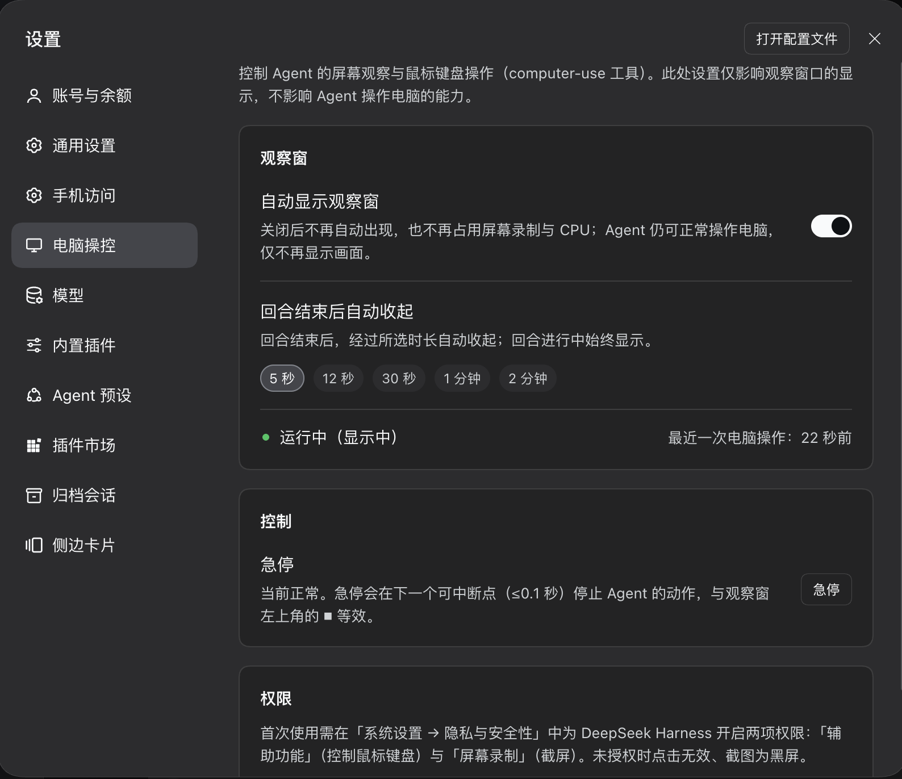

**English** | [中文](README.md)

# dsh-computer-use

**Let a DeepSeek Harness agent see the screen, move the mouse and keyboard, and act on UI elements.**

A DSH plugin for macOS: it ships a stdio MCP server that shows up in your session as
`mcp__computer-use__*` tools, plus a **Settings → Computer use** page with the observation-window
switch, the emergency stop, and permission guidance.



## What it looks like

Whenever the agent touches the computer, a small **observation window** floats on screen showing a
live view of the window it is driving. You can watch it work, or hit ⏹ in its top-left corner to
stop it immediately (it halts at the next interruptible point, ≤0.1 s). The settings page (above)
lets you hide the window, choose how long it stays after a turn ends, stop/resume by hand, and see
the state of the two macOS permissions.

## Requirements

| | |
|---|---|
| OS | macOS 13+ (Intel or Apple Silicon) |
| Python | 3.10+ (3.12 is what it is tested on; the python.org framework build is best) |
| Node | 22+ with npm (to build the host half; `lib/` is a build artifact and is not in the repo) |
| DeepSeek Harness | **0.2.0-rc.2 or newer (0.2.x)** — declared in `peerDependencies`; DSH refuses to load it on an incompatible version |
| Permissions | Accessibility + Screen Recording, see below |
| Disk | ~130 MB (`.venv` is 96 MB of that) |
| Optional | Xcode Command Line Tools — only to compile the capture helper; without it the plugin falls back to `screencapture` |

## Install

One command, safe to re-run:

```bash
git clone https://github.com/OGHong/dsh-computer-use && cd dsh-computer-use
sh scripts/install.sh
```

It does all of this:

1. creates `.venv` and installs the dependencies (pyobjc is what the observation window needs);
2. builds the host half (`src/index.ts` → `lib/index.js`);
3. rewrites the absolute paths in `cordis.patch.yml` to point at your checkout;
4. tries to compile the capture helper (falls back to `screencapture` if it cannot);
5. **wires the plugin into your profile**: adds a `link:` dependency, appends it to
   `dsh.profile.bundles`, and creates the `node_modules` symlink (backing up `package.json` first);
6. opens the two permission panes in System Settings.

Want to see what it would do first: `sh scripts/install.sh --dry-run`.
Other flags: `--profile=web`, `--no-open-settings`.

**Two things nobody can do for you** — this is not the plugin being lazy:

1. **Restart DeepSeek Harness**: plugin manifests (host and client) are scanned at startup, so a
   hot reload will not pick them up;
2. **Flip the two switches in System Settings**: Accessibility (to control mouse and keyboard) and
   Screen Recording (to take screenshots). macOS TCC permissions cannot be granted by an app to
   itself — only you can click them. Without them screenshots are black and clicks do nothing;
   `screen_info` reports the real state.

## Usage

Just say what you want in a session, for example:

- "Take a look at what's on my screen" → `screen_info` / `screenshot`
- "Open Calculator and work out 1234×567" → `launch_app` plus element-path clicks
- "Change the title of this document to …" → `get_ax_state` then `set_value` / `type_text`

There are two action paths: the **element path** (drives accessibility elements, works on
background apps, does not steal your mouse — preferred) and the **screenshot-coordinate path**
(a fallback for games, canvases and other UI without accessibility data). Every action returns an
`effect:` line as evidence; `unchanged` means that step did nothing.

## Tools

| Group | Tools |
|---|---|
| Look first | `screen_info` `screenshot` `list_apps` `list_windows` |
| Bind an app (also takes the controller lease) | `get_app` `focus_app` `focus_window` `release_lease` |
| Element path (preferred) | `get_ax_state` `elements` `click_element` `set_value` `perform_action` `select_text` |
| Coordinate path (fallback) | `click` `drag` `scroll` `type_text` `press_key` `paste` `wait` `launch_app` |
| Batching and safety | `sequence` `run_code` `stop` `resume` `preview` |
| Other | `run_shell` `open_permission_settings` |

Arguments, the `effect:` evidence and failure codes are documented in
[docs/DESIGN.md](docs/DESIGN.md); `sequence` / `run_code` can do everything the tools can (same
registry, see `server/action_layer.py`).

Use `sequence` for short fixed chains (≤5 steps, no branches); use `run_code` when the number of
steps depends on what the program sees and you need loops, conditions or checks. `run_code`
projects actions as `mu.<action>(...)`; `run_shell` is not on `mu` unless `allow_shell=true`.

## Settings page

| Control | What it does |
|---|---|
| Show the observation window automatically | Turned off, it never appears and stops using screen capture and CPU; the agent still drives the computer |
| Auto-hide after a turn | 5 s / 12 s / 30 s / 1 min / 2 min |
| Stop / Resume | Same as ⏹ in the window: halts at the next interruptible point (≤0.1 s) |
| Permissions | Jumps straight to System Settings → Accessibility |

## Configuration overrides

Override by id in your profile's `cordis.patch.yml` (do not add a second `insert`, it would
register twice):

```yaml
- id: computer-use
  config:
    command: /path/to/other/python
    toolCallTimeoutMs: 120000
```

## Known limits (the ones you will actually hit)

- `type_text` / `paste` go through the clipboard and will overwrite what you had copied;
- coordinates are relative to the **most recent screenshot**: full-screen and single-window
  screenshots have different pixel origins, and every action reports a `坐标系:` line saying which;
- **the emergency stop persists across sessions**: after a stop, a new session starts read-only
  until you call `resume()` or press ▶ in the window;
- element indices stay stable between two observations; after a big UI change, let the agent
  observe again;
- under the `a11y` strategy, actions with no semantic equivalent (dragging, for instance) **fail
  loudly instead of silently falling back** — that is deliberate.

## Implementation notes

Architecture, the trade-offs behind the two action paths, multi-session isolation, the emergency
stop and controller lease, measured performance, and how to run the checks all live in
**[docs/DESIGN.md](docs/DESIGN.md)** (Chinese).

```bash
npm run verify     # typecheck + build + every smoke assertion
```

## License

MIT
